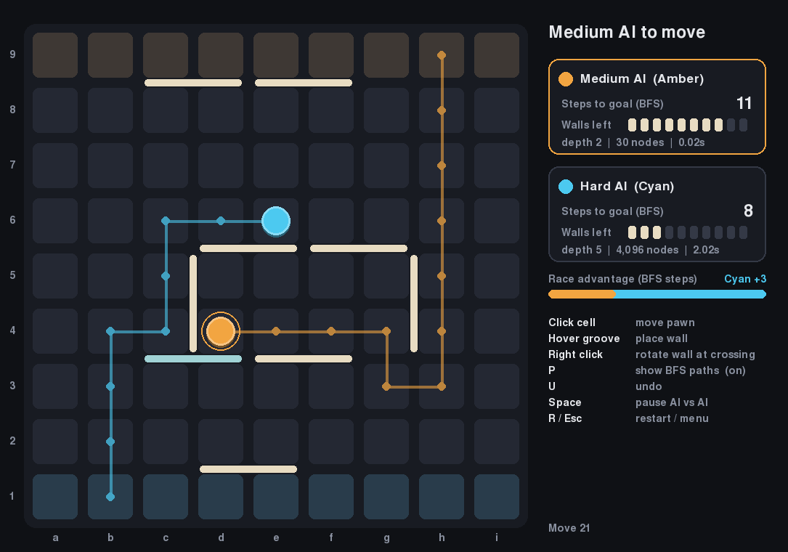
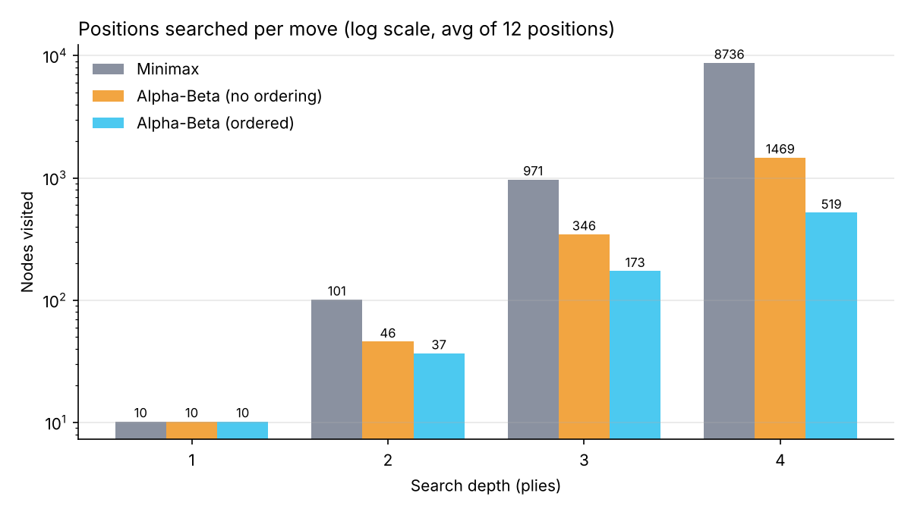
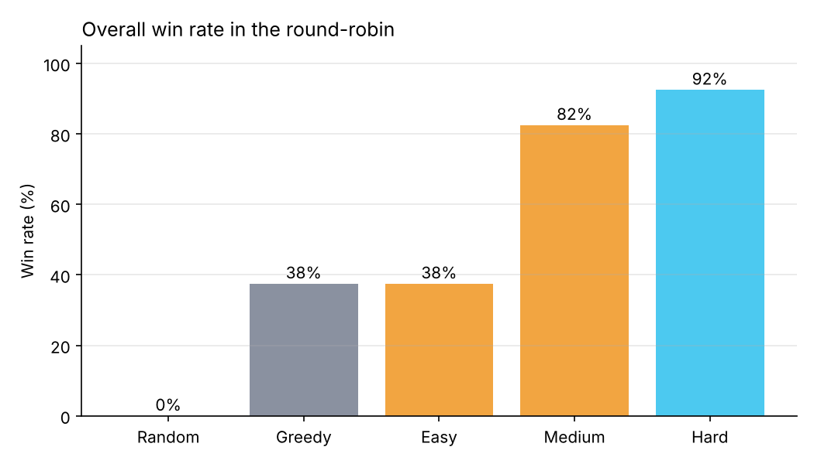

# Quoridor AI

A Quoridor game you can play against an AI, or watch two AIs play each other.
The AI uses **Alpha-Beta search** to look ahead and **BFS / A\* shortest paths** to judge positions.



## Team: Offic

| Name               | Roll Number |
|--------------------|-------------|
| Parth Bhosale      | B24CS033    |
| Shivangshu Sarma   | B24CS041    |
| Sumagna Das        | B24CS044    |
| Vedant Zala        | B24CS054    |
| Kanishk Nandeshwar | B24DS010    |

---

## Run it

```bash
pip install -r requirements.txt
python main.py
```

Python 3.9+. The game uses `pygame-ce` (a maintained fork of pygame that installs cleanly on new Python versions).

## The game

Quoridor is played on a 9×9 board. Each player has a pawn and 10 walls.

- **Goal:** be the first to get your pawn to the opposite side.
  Amber starts at the bottom and moves first; Cyan starts at the top.
- **On your turn** you either move your pawn one square (up, down, left, right),
  or place a wall to slow your opponent down.
- **Walls** are 2 squares long. They cannot overlap or cross another wall, and they
  **can never completely block a player**: there must always be some route to the goal.
- **Jumping:** if the pawns are face to face, you can jump over the other pawn.
  If a wall or the board edge is behind it, you can step diagonally around it instead.

### Modes

- **Human vs AI**: pick Easy, Medium or Hard, and whether you move first.
- **AI vs AI**: pick a level for each side and watch.

### Controls

| Input | Action |
|---|---|
| Click a highlighted square | Move your pawn |
| Hover a groove between squares, then click | Place a wall (preview in your colour = legal, red = illegal) |
| Right click | Rotate the wall when hovering where two grooves cross |
| `P` | Show / hide both players' BFS shortest paths |
| `U` | Undo your last move (and the AI's reply) |
| `Space` | Pause / resume (AI vs AI) |
| `R` / `Esc` | Restart / back to menu |

The side panel shows each player's BFS distance to goal, walls left, the race
advantage, and the AI's last search (depth reached, positions searched, time).

---

## How the AI works

### 1. Judging a position: shortest paths

Quoridor is a race, so the most important number is **how many steps each player
still needs**. We get it with **BFS** on the 9×9 grid, treating walls as removed edges.
The goal is a whole row, so BFS stops at the first goal-row square it reaches.
We also implemented **A\*** with `h = rows left to the goal`. That heuristic is admissible and
consistent (each step changes the row by at most 1), so it finds the same shortest path
while expanding about **3× fewer squares** than BFS.

BFS is also what enforces the "never fully block a player" rule: a wall is legal only if
both players still have a path after it is placed.

**Evaluation function** (from the point of view of the player we are scoring):

```
score = 10 × (opponent's distance − my distance)
      +  3 × (my walls left − opponent's walls left)
```

A win scores ±100,000 (plus a bonus for winning sooner).

### 2. Looking ahead: Minimax with Alpha-Beta pruning

The AI searches the game tree a few moves ahead with **negamax** (minimax written from
the side-to-move's view) and **alpha-beta pruning**. Alpha-beta gives exactly the same
answer as minimax but skips branches the opponent would never allow.

### 3. Making it fast enough

| Problem | Fix |
|---|---|
| ~120 legal moves per turn (mostly walls). Depth 2 would mean ~14,000 positions. | **Wall pruning:** only try walls that cut the opponent's current shortest path, and keep the ones that actually make it longer. ~120 moves → ~11. |
| Alpha-beta prunes well only if good moves are searched first. | **Move ordering:** each move gets a quick score (my path shorter / opponent's path longer); search best-first. |
| Fixed depth is either too slow or too shallow. | **Iterative deepening** (Hard): search depth 1, 2, 3… until the time limit, keep the deepest finished answer. |

### 4. Difficulty levels

| Level | Search |
|---|---|
| Easy | Depth 1, 4 candidate walls, plays a plain greedy move 40% of the time |
| Medium | Alpha-Beta depth 2, 8 candidate walls |
| Hard | Alpha-Beta with iterative deepening up to depth 6, 12 candidate walls, 2 s per move (usually reaches depth 4-5) |

The AI runs on a background thread so the window never freezes while it thinks.

---

## Results

Full write-up in [REPORT.md](REPORT.md). Run the experiments yourself with
`python -m experiments.run_all`.

**Alpha-Beta vs Minimax** (same moves chosen, average over 12 mid-game positions):

| Depth | Minimax | Alpha-Beta | Alpha-Beta + ordering |
|---|---|---|---|
| 2 | 101 | 46 | 37 |
| 3 | 971 | 346 | 173 |
| 4 | 8,736 | 1,469 | **519** (17× fewer) |



**Tournament** (each pair plays 10 games, alternating who moves first):



Overall win rate: **Hard 92%**, Medium 82%, Greedy 38%, Easy 38%, Random 0%.
Hard beat Medium 7–3 and won every game against the weaker agents. No game was drawn.

---

## Project structure

```
main.py                     start the game
quoridor/
  config.py                 board size, walls per player, start/goal rows
  board.py                  game rules: pawn moves, jumps, walls, legality, apply/undo
  pathfinding.py            BFS and A* to the goal row
  ai/
    evaluation.py           heuristic score of a position
    movegen.py              wall pruning + move ordering
    agents.py               Random, Greedy, Minimax, Alpha-Beta, difficulty levels
  gui/
    app.py                  Pygame menu, board, wall preview, side panel, AI thread
    theme.py                sizes and colours
experiments/
  benchmark.py              minimax vs alpha-beta nodes, branching factor, BFS vs A*
  tournament.py             round-robin between all agents
  plot_results.py           charts -> experiments/results/plots/
  run_all.py                run everything
tests/                      pytest: rules, walls, jumps, pathfinding, AI
REPORT.md                   project report
```

## Tests

```bash
python -m pytest
```

21 tests covering wall geometry and legality (including walls that would seal a player in),
straight and diagonal jumps, BFS = A\* distances, and the AI taking wins and blocking losses.
