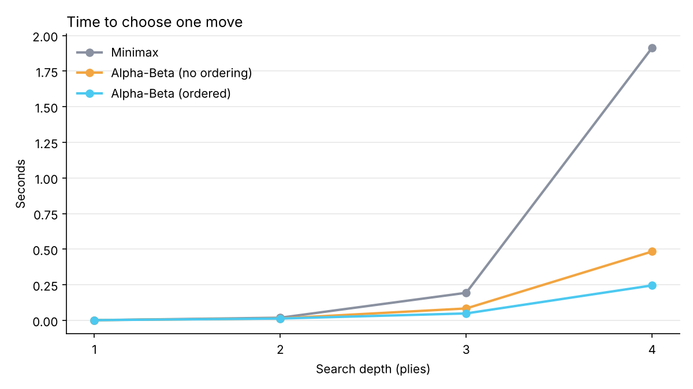
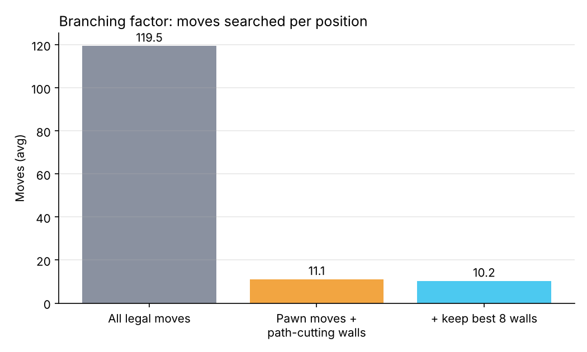

# Quoridor Player: Alpha-Beta Agent with BFS / A* Path Evaluation

**Team Offic:** Parth Bhosale (B24CS033), Shivangshu Sarma (B24CS041), Sumagna Das (B24CS044),
Vedant Zala (B24CS054), Kanishk Nandeshwar (B24DS010)

## 1. Problem

Quoridor is a two-player, zero-sum, deterministic, fully observable board game. Each player
races a pawn across a 9×9 board while placing walls to lengthen the opponent's route.
The aim of the project is an agent that plays it well in real time (a few seconds per move).

What makes it hard for search:

- **High branching factor.** On an empty board a player has 3 pawn moves and 128 wall
  placements, so ~131 moves. In our sampled mid-game positions the average was **119.5** legal
  moves. Chess averages about 35.
- **Walls change the board permanently**, so a single move can swing the race by several steps.
- **A global legality rule:** a wall is illegal if it leaves either player with no route to
  the goal. Checking it needs a graph search.

## 2. Formulation as an adversarial search problem

| Component | Definition |
|---|---|
| State | Both pawn positions, the set of horizontal and vertical walls, walls left per player, player to move |
| Actions | Move the pawn one step (with straight or diagonal jumps over the opponent), or place a horizontal / vertical wall at one of 8×8 anchor points |
| Transition | Apply the move; walls are stored by anchor so a wall blocks two edges of the grid graph |
| Terminal test | A pawn reaches its goal row (we also stop at 200 plies and call it a draw) |
| Utility | +1 for the winner, −1 for the loser (scaled to ±100,000 inside the search) |

The board is a **grid graph**: 81 nodes, edges between adjacent squares, and a wall deletes
two edges.

## 3. Pathfinding: BFS and A*

Both players' shortest routes are needed constantly: for wall legality, for the evaluation
function and for choosing which walls to search.

- **BFS** from the pawn, stopping at the first square on the goal row. All steps cost 1, so BFS
  finds a shortest path. The opponent's pawn is ignored because it is not a lasting obstacle
  (it moves every turn and can be jumped).
- **A\*** with `h(n) = |row(n) − goal row|`. Each step changes the row by at most 1, so
  `h(n) ≤ cost(n, n') + h(n')`: the heuristic is **consistent**, hence admissible, and A\* returns
  the same optimal distance.

Over 24 measurements (12 positions × 2 players), the average shortest route was 5.2 steps.

| | Squares expanded (avg) |
|---|---|
| BFS | 30.2 |
| A\* | 10.3 |

A\* expands about **3× fewer squares** for the same answer. We kept BFS in the evaluation because it
is simpler to explain and the grid is tiny (one BFS takes ~50 µs). A\* is used and compared in the
experiments, and the tests check that both always agree.

## 4. Evaluation function

```
eval(s, p) = 10 × (dist(opponent) − dist(p)) + 3 × (walls_left(p) − walls_left(opponent))
```

- **Path difference** is the core of the game: whoever needs fewer steps is winning the race.
- **Walls in hand** are future chances to slow the opponent. A small weight means walls are still
  placed when they help the race, but are not thrown away.
- Terminal positions score ±(100,000 + remaining depth), so the agent prefers faster wins and
  slower losses.

## 5. Search

### Negamax with Alpha-Beta pruning

We use the negamax form of minimax: `value(s) = max over moves m of −value(result(s, m))`,
with alpha-beta cut-offs when `alpha ≥ beta`. Minimax is the same code with pruning switched off,
which makes the comparison fair. In every test position both returned **identical scores**,
confirming that pruning never changes the decision, only the work.

### Wall pruning (branching factor 119.5 → ~10)

A wall can only lengthen the opponent's route if it **cuts the opponent's current shortest path**.
Otherwise that path is still there. So we:

1. take the opponent's BFS shortest path,
2. list the wall spots that block one of its steps (2 per step),
3. place each one temporarily, re-run BFS for both players, and keep it only if it is legal and
   makes the opponent's path strictly longer,
4. keep the best `k` walls (k = 4 / 8 / 12 for Easy / Medium / Hard).

This is a heuristic cut, so it can miss "setup" walls whose value only appears later, but it
reduces the moves searched per position from **119.5 to 10.3** on average.

### Move ordering

Each candidate gets a cheap score: for a pawn move, how much it shortens my route; for a wall,
(opponent's route gain − my route loss). Searching high scores first makes alpha-beta cut-offs
happen earlier.

### Iterative deepening (Hard)

Hard searches depth 1, 2, 3, … up to 6 until its time budget runs out, and plays the best move
from the deepest **finished** iteration. The previous iteration's best move is searched first.
In the game, with 2 seconds per move, Hard usually reaches depth 4-5.

## 6. Experiments and results

All numbers come from `python -m experiments.run_all`. Raw data is in `experiments/results/*.csv`.

### 6.1 Minimax vs Alpha-Beta

Average over 12 mid-game positions (same wall pruning for all three, k = 8):

| Depth | Minimax nodes | Alpha-Beta nodes | Alpha-Beta + ordering nodes | Minimax time | Ordered AB time |
|---|---|---|---|---|---|
| 1 | 10.2 | 10.2 | 10.2 | 0.002 s | 0.002 s |
| 2 | 101.1 | 45.8 | 36.8 | 0.019 s | 0.013 s |
| 3 | 971.2 | 345.9 | 173.2 | 0.194 s | 0.049 s |
| 4 | 8,736.0 | 1,468.6 | 519.1 | 1.914 s | 0.246 s |


- Minimax grows by ~10× per ply, matching the branching factor of ~10 after wall pruning.
- Alpha-Beta alone visits 6× fewer nodes at depth 4. Adding move ordering takes that to
  **17× fewer nodes (8× faster)**, moving toward the theoretical best case of about b^(d/2) leaves.
- Depth 1 is identical for all three: with one ply there is nothing to prune.



### 6.2 Branching factor



Without wall pruning, depth 4 at a branching factor of ~120 would mean ~2×10⁸ positions:
not feasible in Python. With pruning it is ~10⁴ for minimax and ~500 for ordered alpha-beta.

### 6.3 Tournament

Five agents, round-robin, 10 games per pair (100 games), swapping who moves first every game.
For speed, Hard got 1 second per move here (2 seconds in the game).

| Agent | Random | Greedy | Easy | Medium | Hard | Overall |
|---|---|---|---|---|---|---|
| **Random** (any legal move) | – | 0/10 | 0/10 | 0/10 | 0/10 | 0% |
| **Greedy** (follow BFS path, no walls) | 10/10 | – | 5/10 | 0/10 | 0/10 | 38% |
| **Easy** (depth 1, 40% greedy) | 10/10 | 5/10 | – | 0/10 | 0/10 | 38% |
| **Medium** (alpha-beta depth 2) | 10/10 | 10/10 | 10/10 | – | 3/10 | 82% |
| **Hard** (iterative deepening, 1 s) | 10/10 | 10/10 | 10/10 | 7/10 | – | **92%** |


Observations:

- **Deeper search wins.** The ranking follows search depth exactly: Random < Greedy ≈ Easy < Medium < Hard.
- **Look-ahead is what makes walls useful.** Greedy never places walls and Easy almost never
  does (0.3 per game). Medium used 3.9 walls per game and Hard 8.0, and that is how they beat the
  pure racers: a single well-placed wall costs a move but can add several steps to the
  opponent's route, and only a search can see that trade.
- **Easy ≈ Greedy (5–5).** By design Easy is a depth-1 search that plays greedily 40% of the
  time, which makes it beatable by a human.
- **Hard vs Medium games are long** (63 plies on average vs 14–33 for other pairings): both sides
  spend their walls, and the game turns into a maze fight.
- **Moving first** is usually thought to be an advantage. Here the first mover won 46 of 100
  games, so with agents this unequal the skill gap dominates.

## 7. Limitations and future work

- **Pruning misses setup walls.** We only consider walls that immediately lengthen the
  opponent's path. Strong human players build structures over several moves.
- **Simple evaluation.** It ignores *how fragile* a route is (one long corridor that one more
  wall would block vs many alternative routes). Counting how many walls are needed to cut a path
  would make it stronger.
- **No transposition table.** The same position can be reached by different move orders,
  especially in wall-heavy endgames. Zobrist hashing would avoid re-searching them.
- **Python speed.** A bitboard representation would allow deeper search in the same time.
- **MCTS** would be an interesting comparison, but random playouts are weak in Quoridor,
  so it would need a guided playout policy (for example, follow the BFS path).

## 8. How to reproduce

```bash
pip install -r requirements.txt
python main.py                      # play
python -m pytest                    # 21 tests
python -m experiments.run_all       # benchmarks + tournament + plots (~15 min)
```
