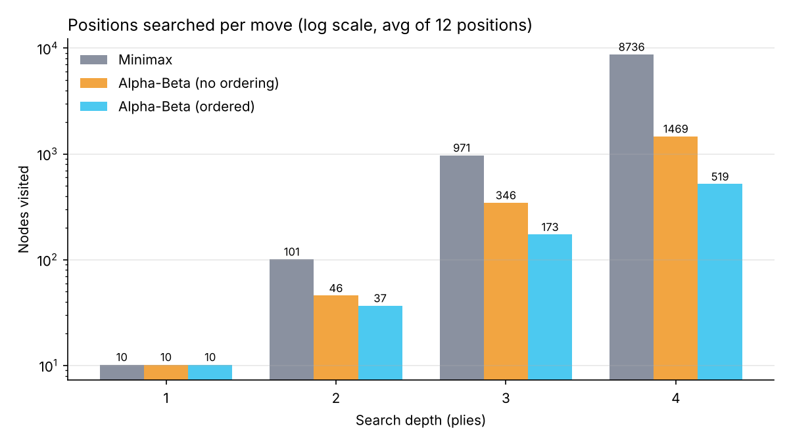
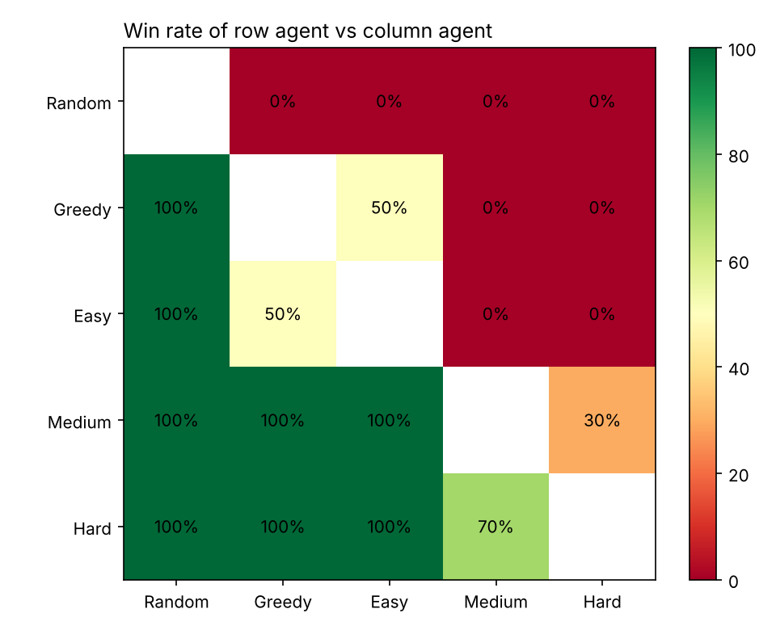

# Quoridor Player: Alpha-Beta Agent with BFS / A* Path Evaluation

**Team Offic:** Parth Bhosale (B24CS033), Shivangshu Sarma (B24CS041), Sumagna Das (B24CS044),
Vedant Zala (B24CS054), Kanishk Nandeshwar (B24DS010)

## 1. Problem

Quoridor is a two-player, zero-sum, deterministic, fully observable game. Each player races a pawn
across a 9×9 board and can place walls to lengthen the opponent's route. The hard part for search is
the **branching factor**: about 120 legal moves per turn (mostly wall placements), versus about 35 in chess.

| Component | Definition |
|---|---|
| State | Both pawn positions, walls on the board, walls left per player, player to move |
| Actions | Move the pawn one step (with jumps over the opponent), or place a horizontal/vertical wall at one of 8×8 anchor points |
| Terminal test | A pawn reaches its goal row |
| Utility | +1 win / −1 loss |

The board is a grid graph (81 nodes). A wall deletes two edges, and it is only legal if both players
still have a path to their goal afterwards.

## 2. Pathfinding: BFS and A*

- **BFS** from the pawn to the first square on the goal row gives the shortest route, since all steps cost 1.
- **A\*** with `h(n) = rows left to the goal`. A step changes the row by at most 1, so `h` is
  **consistent** (hence admissible) and A\* returns the same distance.

On 12 mid-game positions, BFS expanded 30.2 squares on average and A\* expanded 10.3: about 3× fewer for the same answer.

## 3. Evaluation function

```
eval = 10 × (opponent's distance − my distance) + 3 × (my walls left − opponent's walls left)
```

Whoever needs fewer steps is winning the race, and walls in hand are future chances to slow the
opponent. Wins score ±100,000, with a bonus for winning sooner.

## 4. Search

- **Negamax with alpha-beta pruning.** Minimax is the same code with pruning off, so the comparison is fair.
- **Wall pruning:** only try walls that cut the opponent's current shortest path and make it longer
  (any other wall leaves that path intact). This cuts the moves searched from **119.5 to ~10** per position.
- **Move ordering:** moves that shorten my route or lengthen the opponent's are searched first, so cut-offs happen earlier.
- **Iterative deepening (Hard):** search depth 1, 2, 3… until the time limit and play the deepest finished result.

| Level | Search |
|---|---|
| Easy | Depth 1, plays greedily 40% of the time |
| Medium | Alpha-beta depth 2 |
| Hard | Iterative deepening, 2 s per move (usually reaches depth 4–5) |

## 5. Results

### Minimax vs Alpha-Beta

Average nodes per move over 12 mid-game positions. All three always returned the **same score**.

| Depth | Minimax | Alpha-Beta | Alpha-Beta + ordering |
|---|---|---|---|
| 2 | 101 | 46 | 37 |
| 3 | 971 | 346 | 173 |
| 4 | 8,736 | 1,469 | **519** |

At depth 4, alpha-beta with ordering visits **17× fewer nodes** and is about 8× faster (0.25 s vs 1.9 s).



### Tournament

Round-robin, 10 games per pair, swapping who moves first.

| Agent | Random | Greedy | Easy | Medium | Hard | Overall |
|---|---|---|---|---|---|---|
| Random | – | 0/10 | 0/10 | 0/10 | 0/10 | 0% |
| Greedy (follow BFS path) | 10/10 | – | 5/10 | 0/10 | 0/10 | 38% |
| Easy | 10/10 | 5/10 | – | 0/10 | 0/10 | 38% |
| Medium | 10/10 | 10/10 | 10/10 | – | 3/10 | 82% |
| Hard | 10/10 | 10/10 | 10/10 | 7/10 | – | **92%** |



Strength follows search depth. Look-ahead is also what makes walls useful: Greedy never places
walls, while Medium used 3.9 per game and Hard 8.0. A wall costs a move but can add several steps
to the opponent's route, and only a search can see that trade.

## 6. Limitations

- Wall pruning misses "setup" walls whose value only shows a few moves later.
- The evaluation ignores how fragile a route is (one corridor vs many alternatives).
- There is no transposition table, so repeated positions get searched again.

## 7. Reproduce

```bash
pip install -r requirements.txt
python main.py                  # play
python -m pytest                # tests
python -m experiments.run_all   # benchmarks + tournament + plots
```
